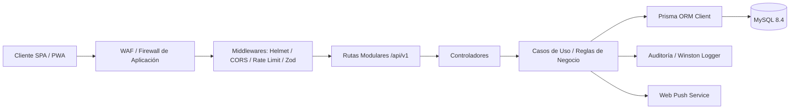
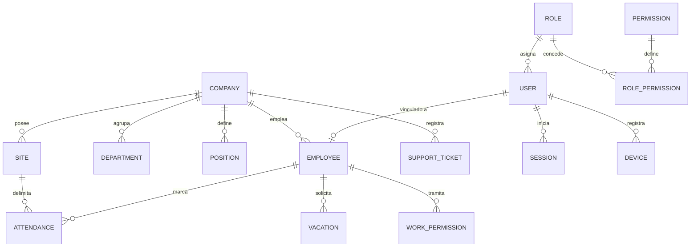

# MSA Asistencia API & Web PWA

Plataforma empresarial de control de asistencia, gestión de recursos humanos y soporte técnico para **MSA Automotriz**. Diseñada bajo los principios de **Clean Architecture**, con backend en TypeScript/Express 5, base de datos MySQL gestionada con Prisma ORM, y un frontend SPA/PWA con capacidades offline y geocercas GPS.

---

## Arquitectura del Sistema





---

## Funcionalidades y Módulos Principales

### 1. Control de Asistencia y Geolocalización (GPS)
* **Marcación Digital Completa:** Registro de Entrada (`CHECK_IN`), Salida a refrigerio (`BREAK_OUT`), Retorno de refrigerio (`BREAK_IN`) y Salida de jornada (`CHECK_OUT`).
* **Geocercas por Sede:** Validación en tiempo real de la distancia física respecto a las coordenadas geográficas de la sede asignada (radio en metros configurable).
* **Modo Offline & Sincronización:** Tokens temporales cifrados (`OfflineAttendanceToken`) y Service Worker para registrar asistencia sin conexión a internet y sincronizarla automáticamente al recuperar la red.
* **Control de Tolerancia y Reglas de Horario:** Evaluación de puntualidad, tardanzas justificadas/injustificadas y cálculo de minutos de exceso.

### 2. Multi-empresa, Multi-sede y Organización
* Soporte para múltiples razones sociales y sedes de operación desde una consola centralizada.
* Configuración de departamentos, cargos/posiciones y turnos de trabajo (normales, nocturnos, rotativos, tiempo parcial y flexibles).
* Importación masiva de colaboradores mediante plantillas de Excel.

### 3. Portal del Empleado y Trámites (Autoservicio)
* **Gestión de Solicitudes:** Trámite de vacaciones, permisos laborales, licencias y solicitudes de horas extra.
* **Sustentos y Evidencias Digitales:** Soporte para adjuntar archivos probatorios (PDF, imágenes JPG/PNG) en solicitudes de permisos o licencias.
* **Calendario Interactivo:** Consulta visual de asistencias, permisos aprobados, días festivos y cumpleaños de compañeros de trabajo.
* **Perfil de Usuario:** Actualización de datos, cambio de contraseña y configuración de preguntas de seguridad para recuperación de cuenta.

### 4. Mesa de Ayuda y Soporte Técnico (Tickets)
* **Módulo de Incidencias:** Registro de tickets categorizados (Hardware, Software, Red, Asistencia, Correo, Impresoras, Otros).
* **Gestión por Prioridad y Asignación:** Flujo de estados (`PENDING`, `IN_PROGRESS`, `RESOLVED`, `CLOSED`, `REJECTED`) con asignación a personal técnico responsable.
* **Adjunto de Evidencias:** Carga de capturas de pantalla o fotografías del problema técnico y registro de notas de resolución.

### 5. Reportes y Analítica
* **Exportación Multiformato:** Generación y descarga de reportes de asistencia y solicitudes en **PDF**, **Excel (.xlsx)** y **CSV**.
* **Filtros Avanzados:** Filtrado por rango de fechas, empresa, sede, departamento y colaborador.
* **Dashboard Operativo:** Indicadores clave de rendimiento (KPIs), métricas en tiempo real y registro de actividad reciente.

### 6. Seguridad, Control de Acceso y Auditoría
* **Firewall de Aplicación (WAF Integrado):** Detección e intercepción activa de vectores de ataque (SQL Injection, XSS, Path Traversal) en cabeceras, parámetros y cuerpo de solicitudes.
* **Control de Acceso Basado en Roles (RBAC):** Permisos granulares asignables a roles y autorizaciones específicas a nivel de usuario.
* **Huella Digital de Dispositivos (Fingerprinting):** Reconocimiento de dispositivos usados por los colaboradores, con flujo de aprobación o bloqueo.
* **Seguridad de Sesiones:** Autenticación JWT con rotación de refresh tokens, protección contra fuerza bruta y bloqueo temporal por intentos fallidos.
* **Trazabilidad y Auditoría (`AuditLog`):** Bitácora inmutable de eventos críticos (creación, edición, eliminación, aprobaciones y accesos).

### 7. Comunicados y Notificaciones
* **Avisos Corporativos:** Publicación de comunicados y noticias con segmentación por rol y fecha de vigencia.
* **Notificaciones Multicanal:** Alertas en la aplicación (*in-app*) y Notificaciones Web Push (*VAPID*) directo al navegador del colaborador.

### 8. Respaldos y Mantenimiento del Sistema
* **Copias de Seguridad Automatizadas:** Programador periódico (`BackupScheduler`) y respaldos manuales de la base de datos MySQL y archivos de almacenamiento.
* **Diagnóstico de Salud:** Endpoint de monitoreo `/api/v1/health` para verificación de estado y latencia.

---

## Estructura del Repositorio

```text
msa_asistencia/
├── prisma/                        # Esquema de Prisma, semillas y migraciones MySQL
│   ├── migrations/                # Historial de migraciones SQL
│   ├── schema.prisma              # Definición de modelos de datos y relaciones
│   ├── seed.ts                    # Semillas de roles, usuarios y permisos del sistema
│   └── seed-employees.ts          # Datos demostrativos de colaboradores
├── public/                        # Frontend SPA & PWA (Vanilla JS modular)
│   ├── css/                       # Sistema modular de diseño (base, componentes, vistas)
│   ├── images/                    # Recursos visuales e identidad corporativa
│   ├── js/                        # Lógica cliente (core, componentes, módulos funcionales)
│   ├── vendor/                    # Librerías cliente (Leaflet para mapas, QR scanner)
│   ├── views/                     # Vistas parciales y plantillas HTML dinámicas
│   ├── index.html                 # Shell principal de la aplicación SPA
│   ├── manifest.webmanifest       # Manifiesto de instalación PWA
│   └── service-worker.js          # Service Worker para caché y sincronización offline
├── src/                           # Backend TypeScript (Clean Architecture)
│   ├── common/                    # Manejo de errores y respuestas HTTP uniformes
│   ├── config/                    # Carga y validación de variables de entorno
│   ├── controllers/               # Controladores base y CRUD genéricos
│   ├── database/                  # Conexión cliente Prisma ORM
│   ├── docs/                      # Documentación interactiva Swagger / OpenAPI
│   ├── middleware/                # WAF, autenticación JWT, RBAC, subida de archivos y rate-limit
│   ├── routes/                    # Definición de rutas y endpoints de la API REST
│   ├── use-cases/                 # Lógica de dominio y servicios de negocio
│   ├── utils/                     # Utilidades criptográficas, logger Winston y User-Agent
│   ├── app.ts                     # Configuración de Express, middlewares y rutas
│   └── server.ts                  # Servidor HTTP y orquestador de inicio/cierre limpio
├── tests/                         # Suite de pruebas automatizadas (Vitest + Supertest)
├── scripts/                       # Scripts auxiliares de migración y reinicio de servicios
├── docker-compose.yml             # Orquestación de contenedores (API + MySQL 8.4)
└── Dockerfile                     # Construcción de imagen de producción para la API
```

---

## Requisitos Previos

* **Node.js:** Versión `>= 22.0.0`
* **npm:** Versión `>= 10.0.0`
* **MySQL:** Versión `8.0` o superior (o Docker / Docker Compose)

---

## Instalación y Puesta en Marcha

### 1. Clonar el repositorio e instalar dependencias
```bash
git clone <url-del-repositorio>
cd msa_asistencia
npm install
```

### 2. Configuración de Variables de Entorno
Copia el archivo de ejemplo para crear tu configuración local:
```bash
cp .env.example .env
```
Configura en `.env` los valores correspondientes a tu entorno (puerto, conexión a base de datos MySQL, secretos JWT y parámetros SMTP/VAPID). Consulta `.env.example` para la lista completa de variables requeridas.

### 3. Configuración de Base de Datos y Semillas
Para sincronizar el esquema y cargar los roles, permisos y usuarios iniciales:
```bash
npm run db:setup
```

### 4. Ejecución en Modo Desarrollo
Inicia el servidor con recarga en caliente (*hot-reload*):
```bash
npm run dev
```
La aplicación estará disponible por defecto en: `http://localhost:3000`

### 5. Compilación y Ejecución en Producción
```bash
npm run build
npm start
```

---

## Despliegue con Docker

El proyecto incluye configuración para desplegar la base de datos MySQL y la API mediante Docker:

```bash
docker compose up -d --build
```

---

## Calidad de Código y Pruebas

El proyecto cuenta con un conjunto integral de pruebas automatizadas y reglas estrictas de linter y tipado:

```bash
# Ejecutar toda la suite de pruebas unitarias y de integración
npm test

# Ejecutar pruebas en modo observador (watch)
npm run test:watch

# Verificación estática de código con ESLint
npm run lint

# Verificación de tipos TypeScript
npx tsc --noEmit

# Verificación de formato con Prettier
npm run format:check
```

---

## Documentación de la API

Con la aplicación en ejecución, la especificación interactiva de endpoints y modelos (Swagger UI) se encuentra accesible en:
* **Ruta local:** `http://localhost:3000/api/docs`

---

## Manuales de Usuario

En la raíz del proyecto y en el portal web se encuentran disponibles los manuales de operación en formato PDF:
* `Manual_de_Usuario_Administrador_MSA.pdf`
* `Manual_de_Usuario_Empleado_MSA.pdf`